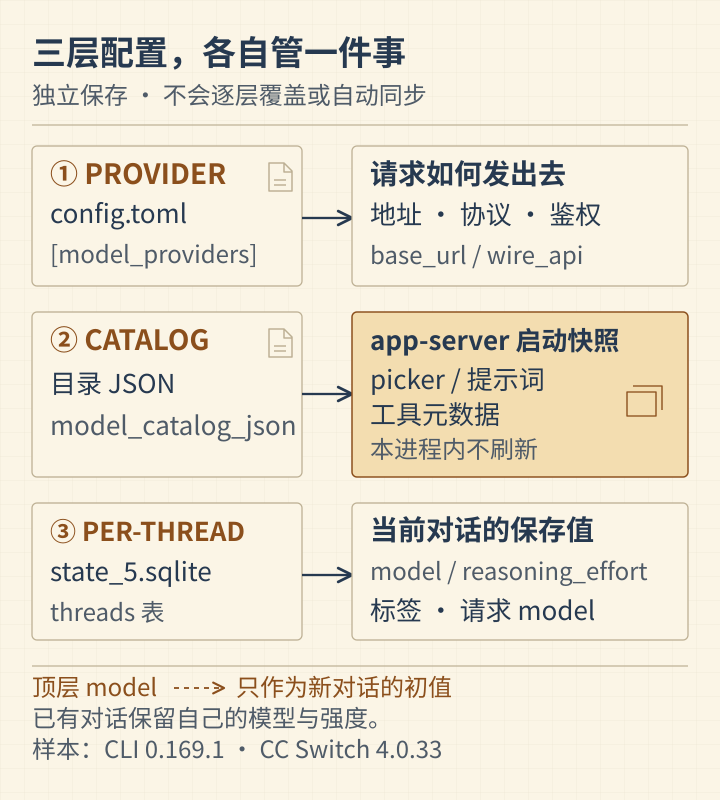
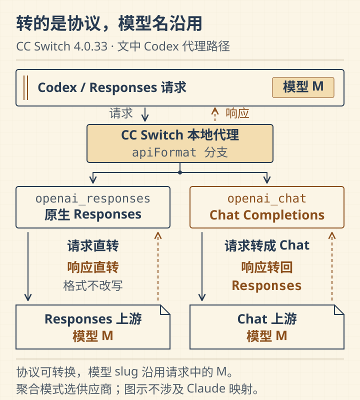
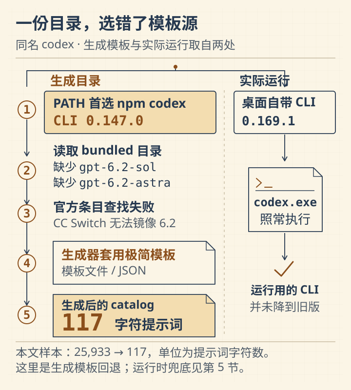
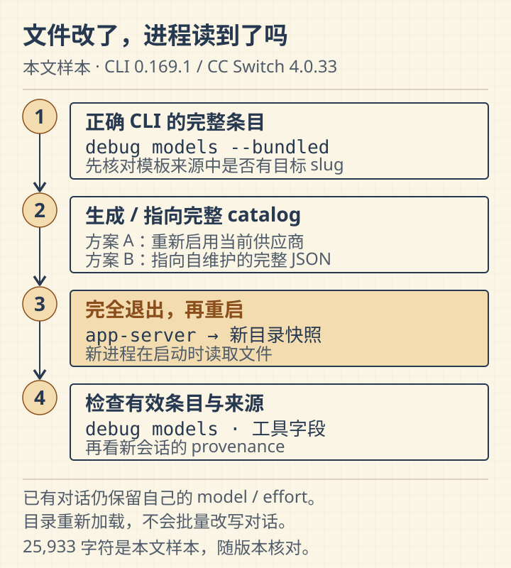

# Codex 自定义模型的三层结构

> 造物手记 · 技术解剖
> 主题：provider / catalog / per-thread 三层各自为政，CC Switch「路由」的真实含义，
> 以及一次 117 字符占位模板导致的模型能力退化。
>
> 环境：Codex CLI 0.169.1 (Windows) · CC Switch 4.0.33（已对照 4.0.36 发版说明）
> 说明：文中账号、密钥、机器路径均已脱敏。

在线阅读：[Codex 模型目录解剖 · 带附图的文章页](https://starrysea1412.github.io/codex-model-catalog-anatomy/)

---

## 一、Codex 的模型配置分三层，互不同步

| 层 | 存哪 | 何时读 | 作用 |
|---|---|---|---|
| ① Provider | `config.toml` 的 `[model_providers.<id>]` | 每个请求 | base_url、wire_api、鉴权 |
| ② Catalog | `model_catalog_json` 指向的 JSON | **app-server 启动时读一次**，进程内不刷新 | 模型的 prompt、工具能力、推理档位、显示名 |
| ③ Per-thread | `state_5.sqlite` 的 `threads.model` / `threads.reasoning_effort` | 打开或恢复对话时 | 这条对话实际用哪个模型、什么强度 |

三者的关系：

- `config.toml` 顶层 `model = "..."` 只是**新对话的种子值**。
- 改它不会修改任何已存在的对话。
- 界面模型标签读的是 ③；picker 能选什么读的是 ②；请求发出去的 model 字段读的是 ③。

因此"配置改了"和"界面变了"和"请求变了"是三件独立的事，各自有各自的观测点。



*FIG. A · 三层各有保存值与观测点。顶层 `model` 只为新对话提供初值；目录快照、当前对话与连接参数各自核对。*

---

## 二、界面显示逻辑

Desktop 端 app.asar 里的渲染代码：

```js
let eB = eW?.displayName ?? z ?? formatMessage({id:"composer.mode.local.model.custom"})
```

- 有 `displayName` 就显示名字，去掉 `gpt-` 前缀（`stripGptPrefix`）。
- 没有才显示 "自定义"（locale 键 `composer.mode.local.model.custom`，
  描述是 *"Custom model from config"*）。

"自定义"是 Codex 对"模型来自 config 而非官方订阅目录"的固有分类，官方标记为
not planned，与是否经过代理无关。

强度标签来自同一 locale 文件：`composer.mode.local.reasoning.xhigh.label = 极高`、
`max.label = Max`。

---

## 三、CC Switch 的三种模式与"路由"的实际含义

源码：GitHub `farion1231/cc-switch`

| 模式 | 行为 | 配置侧改动 |
|---|---|---|
| 直连 direct | 请求不经过 CC Switch | 只改写 `config.toml` 的 base_url 和 key |
| 路由 proxy | 请求经本地服务转发 | base_url → `http://127.0.0.1:15721/v1`，key → `PROXY_MANAGED` |
| 聚合 stack | 按模型把请求分给多家供应商 | 生成合并目录 |

**路由只在协议不一致时做转换。** 判定逻辑（`src-tauri/src/proxy/providers/codex.rs:83`）：

```rust
pub fn should_convert_codex_responses_to_chat(provider, endpoint) -> bool {
    is_codex_responses_endpoint(endpoint)
      && codex_provider_uses_chat_completions(provider)  // meta.apiFormat == "openai_chat"
}
```

供应商是原生 Responses（`apiFormat = "openai_responses"`）时，第 2～4 步转换不发生，
请求直接转给上游。其官方文档原话：
"供应商原生就是 Responses 的……请求直接发往上游，不做任何格式改写。"

CC Switch 的模型映射（`src-tauri/src/proxy/model_mapper.rs`）只处理 Claude 的
haiku/sonnet/opus/fable 档位，对 Codex 不做模型替换。

结论：**CC Switch 的"路由"= 协议转换 + 故障转移 + 请求日志，它不选模型、不改模型名。**



*FIG. B · 同一个模型名，协议分支由供应商的 `apiFormat` 决定。图示对应文中版本的 Codex 代理路径。*

---

## 四、判断"是否真的在路由"的四个检查点

```bash
# 1. 模式声明
cat ~/.cc-switch/live-state.json          # {"codex":{"mode":"direct"|"proxy"}}

# 2. 数据库开关
sqlite3 ~/.cc-switch/cc-switch.db \
  "select app_type, proxy_enabled, enabled from proxy_config where app_type='codex'"

# 3. 端口是否有进程监听
netstat -ano | grep 15721                 # 无输出 = 没有转发服务

# 4. 配置里 base_url 指向哪
grep -A3 '\[model_providers' ~/.codex/config.toml   # 本地 127.0.0.1 才是路由
```

补充：`proxy_request_logs` 表中的记录若 `data_source='codex_session'`、
`provider_id='_codex_session'`，那是从 Codex 会话日志导入的统计，不是代理记账，
不能用来判断是否在路由。

---

## 五、模型名从哪来

模型能选什么，取决于第 ② 层 catalog 的来源，有三种：

1. **内置 slug**：模型名与该版本内置条目一致，直接用内置 metadata。
2. **远程目录**：`<base_url>/models?client_version=x.y.z`，需返回 Codex 格式
   `{"models":[...]}`（只有 ID 列表不够）。自定义路径用 `model_catalog_url`。
3. **本地文件**：`model_catalog_json = "绝对路径"`，启动时加载，**替换**内置目录。

若目录里没有该 slug，Codex 不会拒绝，而是用兜底元数据
（`codex-rs/models-manager/src/model_info.rs:98` `model_info_from_slug()`）：
上下文 272k、无推理档位、无 apply_patch、无 search，prompt 用通用
`BASE_INSTRUCTIONS`，并打一条 warning。

所以"能发请求"与"模型行为正确"是两件事。

---

## 六、一个实际遇到的 catalog 质量问题

CC Switch 生成的 `cc-switch-model-catalog.json` 使用一个极简模板
（`src-tauri/src/resources/codex_native_responses_template.json`，1099 字节）作底，
只覆盖 slug / display_name / 窗口等少数几项。

同一条 `gpt-6.2-sol` 的对比：

| 字段 | Codex 内置条目 | CC Switch 生成条目 |
|---|---|---|
| 字段数 | 40 | 27 |
| system prompt 长度 | 25,933 字符 | **117 字符** |
| apply_patch_tool_type | `freeform` | 缺失（退化为 shell 写文件） |
| supports_search_tool | true | false |
| multi_agent_version | v2 | 缺失 |
| experimental_supported_tools | 5 项 | `[]` |

117 字符的 prompt 全文：

> "You are Codex, a coding agent. You and the user share the same workspace
> and collaborate to achieve the user's goals."

**成因（已查实）**：catalog 生成时调用的模板源是本机 `codex debug models --bundled`
（`src-tauri/src/codex_config.rs:1914`），而这个命令解析到的二进制**不一定是桌面端
在用的那个**。详见下一节的候选顺序与实锤。

**症状**：模型名正确、请求可达，但工具集与提示词退化。

### 6.1 根因实锤：`which codex` 指向一个过期的 npm 垫片

CC Switch 的模板源按以下顺序解析（`codex_config.rs:1581` `CODEX_CLI_FIXED_CANDIDATES`，
之后追加桌面版候选）：

1. PATH 上的 `codex`（所有平台，第一位）
2. Homebrew 的三个固定路径
3. **最后**才是桌面版自带的 `%LOCALAPPDATA%\OpenAI\Codex\bin\<版本>\codex.exe`
   （版本目录按修改时间新→旧取最新）

本机实际情况：

```
which codex
→ <npm global bin>\codex     # npm 垫片，2026-08-12 安装
codex --version
→ codex-cli 0.147.0                            # 落后桌面端两代
```

实测 0.147.0 的内置目录只有 gpt-5.6 / 5.5 / 5.4 系列，**没有 6.2-sol / 6.2-astra**。
于是生成这两个条目时 `find_codex_official_model()`（`codex_config.rs:2403`）找不到
官方镜像，按源码走向 `codex_catalog_model_entry()` 的极简模板 → 117 字符裸奔。

而 6.1-sol / 6-astra 两条之所以有完整的 21K 指令，是因为 provider 行里存了显式
`baseInstructions` 覆盖（`spec.base_instructions` 非空路径）——特例，不是通用机制。

**关键澄清**：受污染的只有 CC Switch 生成的 catalog 元数据。桌面端实际运行的是
`bin/<version-hash>/codex.exe`（0.169.1，未受 npm 垫片影响），请求、rollout、
界面全部正常。这不是客户端 bug，是"生成目录时选错了二进制"的链路问题。

上游也在收敛同类问题：CC Switch v4.0.36 发版说明提到
"聚合模式下新发布的官方模型（如 GPT-6.2）要很久才出现……获取列表时报的 Codex
版本会参考桌面版自带的 CLI"，而本机跑的是 4.0.33。



*FIG. C · 选错的是生成目录时使用的二进制。117 是提示词字符数；桌面运行路径与生成来源要分开检查。*

### 6.2 修复方案（二选一，都绕过 npm 垫片）

**方案 A（推荐）**——清除过期垫片，让候选列表落到桌面版 CLI：

```bash
npm uninstall -g @openai/codex
# 或直接删除 <npm global bin>\codex*
# 之后任选其一：
#   1) 重装最新 CLI：npm install -g @openai/codex
#   2) 不装——CC Switch 会退到桌面版 bin/0.169.1
```

然后在 CC Switch 里对当前供应商重新点一次"启用"（触发目录重新生成），
完全退出并重启 Codex。密钥、路由配置均不变，变的只有目录内容。

**方案 B**——不动系统环境，自行维护 catalog：从 0.169.1 的
`codex debug models --bundled` 取出完整条目，只改 `slug` / `display_name`，
写入独立 JSON 并让 `model_catalog_json` 指向它。这也是官方网关文档推荐的别名做法。



*FIG. D · 先修生成来源，再让新进程读取新快照，最后核对实际条目与 provenance。已有对话仍保留自己的模型与推理强度。*

### 6.3 修复后的验证清单

```bash
# 1. 确认候选解析到了正确的二进制
which codex && codex --version        # 应为 0.169.x，或不存在（由 CC Switch 落到桌面版）

# 2. 确认该二进制的内置目录里有目标模型
codex debug models --bundled | grep -c "gpt-6.2-sol"   # ≥1

# 3. 确认重新生成的 catalog 恢复完整条目
python -c "
import json
d = json.load(open(r'%CODEX_HOME%\cc-switch-model-catalog.json', encoding='utf-8'))
for m in d['models']:
    bi = m.get('base_instructions') or ''
    print(m['slug'], len(bi))
"
# 期望：gpt-6.2-sol / gpt-6.2-astra 的指令长度回到 25933（与官方一致）
# 6.1-sol / gpt-6-astra 保持 21769 / 21420（显式覆盖，不受影响）

# 4. 确认 Codex 实际加载了新目录（必须先完全退出重启）
codex debug models | python -c "
import sys, json
d = json.load(sys.stdin)
for m in d['models']:
    print(m['slug'], m.get('shell_type'), m.get('apply_patch_tool_type'))
"
# 期望：6.2-sol 的 shell_type=unified_exec、apply_patch=freeform

# 5. roll 里的 provenance 应指向模型条目而非退化为占位
grep -o '"provenance":{[^}]*}' <新会话的 rollout.jsonl> | head -1
```

---

## 七、排查命令清单

```bash
# 内置目录（完整 metadata，与账号无关）
codex debug models --bundled

# 当前生效目录（合并 model_catalog_json 之后）
codex debug models

# 每条对话保存的模型与强度
sqlite3 ~/.codex/state_5.sqlite \
  "select model, reasoning_effort, updated_at from threads order by updated_at desc limit 20"

# 每轮请求实际发出的模型（rollout）
grep -m1 '"turn_context"' <rollout 文件>     # payload.model

# 供应商实际支持哪些模型
curl -H "Authorization: Bearer <key>" <base_url>/models

# 配置中有不认识的字段直接报错
codex --strict-config
```

rollout 文件路径：`~/.codex/sessions/YYYY/MM/DD/rollout-<时间>-<uuid>.jsonl`，
完整路径在 `state_5.sqlite` 的 `threads.rollout_path` 列。

`session_meta` 事件里的 `base_instructions.provenance.model` 记录了这条会话的
系统提示词来自哪个模型条目，是验证 catalog 是否生效的直接证据。

---

## 八、要点归纳

1. Provider、Catalog、Per-thread 三层各自独立，改一层不会同步另外两层。
2. Catalog 只在 app-server 启动时读一次；改了 `model_catalog_json` 必须重启进程，
   否则 picker 不变。
3. 修改 `config.toml` 的 `model` 只影响新建对话，已有对话保持自己的保存值。
4. 界面标签读 per-thread 值；请求 model 字段也读 per-thread 值；
   但 picker 可选范围读 catalog 快照。
5. CC Switch 的路由是协议转换，不做模型映射；判断是否在路由看端口、
   `live-state.json`、`proxy_config` 三处。
6. 模型名可达不等于能力完整；catalog 缺条目时 Codex 会用兜底元数据，
   表现正常但工具与 prompt 退化。
7. 工具生成的 catalog 需要核对：用 `codex debug models` 对比字段数与 prompt 长度。
8. **`which <tool>` 上的同名工具不一定是你在用的那个**。生成类工具（如 CC Switch）
   解析二进制时按候选顺序取第一个，PATH 上的过期 npm 垫片会静默劫持整个链路；
   客户端本身正常、只有中间层产物退化，是这类问题的典型指纹。

---

## 附：文件与代码位置

- `~/.codex/config.toml` —— provider、默认 model
- `~/.codex/cc-switch-model-catalog.json` —— CC Switch 生成的 catalog
- `~/.cc-switch/live-state.json`、`~/.cc-switch/cc-switch.db`
  （表：providers / proxy_config / proxy_request_logs）
- `~/.codex/state_5.sqlite` → `threads`（model / reasoning_effort / rollout_path）
- `~/.codex/sessions/**/rollout-*.jsonl` → `session_meta` / `turn_context`
- CC Switch 源码（GitHub `farion1231/cc-switch`）：
  - `src-tauri/src/proxy/providers/codex.rs` —— 路由转换判定
  - `src-tauri/src/proxy/model_mapper.rs` —— 模型映射（仅 Claude）
  - `src-tauri/src/codex_config.rs:1338` —— `codex_catalog_model_entry`
  - `src-tauri/src/codex_config.rs:1581` —— `CODEX_CLI_FIXED_CANDIDATES`（PATH 优先）
  - `src-tauri/src/codex_config.rs:1795` —— `codex_cli_candidates()`（桌面版最后）
  - `src-tauri/src/codex_config.rs:1914` —— 模板源 `debug models --bundled`
  - `src-tauri/src/codex_config.rs:2403` —— `find_codex_official_model`（镜像查找）
  - `src-tauri/src/codex_config.rs:2430` —— `codex_official_model_entry`（镜像生成）
  - `src-tauri/src/services/provider/codex_client_catalog.rs` —— 目录"代次"说明
- Codex 源码（GitHub `openai/codex`）：
  - `codex-rs/models-manager/src/model_info.rs:98` —— `model_info_from_slug()`
  - `codex-rs/config/src/config_toml.rs` —— `model_catalog_json` 仅启动加载
  - `codex-rs/protocol/src/openai_models.rs:1074` —— `base_instructions` 提升为
    `model_messages.instructions_template`

---

## 系列导航

本篇是「造物手记」系列的技术解剖篇之一。系列主线：把「Agent 是怎么干活的」一件件拆开看。

- 系列总目录：<https://starrysea1412.github.io/makers-notebook/>
- 相关往期：[VOL.10 给 Agent 配一台总机（模型路由与降级）](https://github.com/StarrySea1412/agent-switchboard) · [VOL.04 Agent 内核](https://github.com/StarrySea1412/agent-kernel)

## License

MIT
